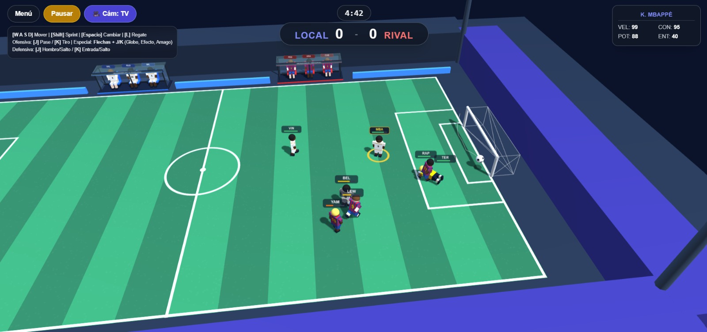
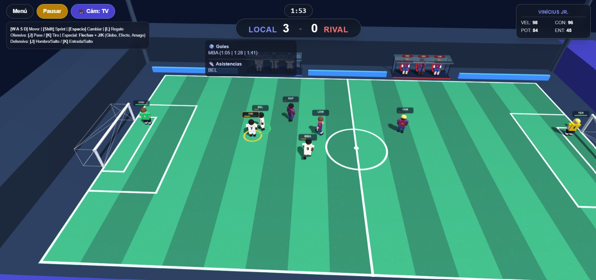
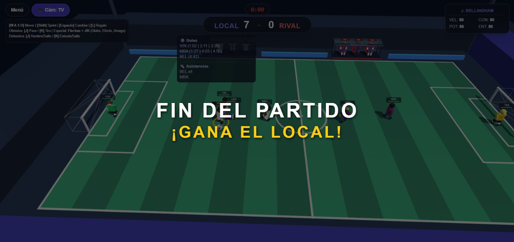

# Champions League: Dreams 3D

A browser-based 3D football game built with JavaScript and Three.js.

Champions League: Dreams 3D is a personal game development project focused on creating an interactive football experience with 3D graphics, configurable teams, tactical formations, player attributes, and AI-controlled opponents.

## Preview



## Features

- **3D Football Environment:** A stadium, pitch, goals, players, and ball rendered with Three.js.
- **Team Selection:** Choose between five available teams.
- **Match Configurations:** Play 3 vs 3, 5 vs 5, and 7 vs 7 matches.
- **Player Customization:** Select players and configure team lineups.
- **Tactical Formations:** Review and adjust suggested player roles before starting a match.
- **Player Attributes:** Individual attributes influence player characteristics and gameplay.
- **AI-Controlled Opponents:** Computer-controlled players participate in match gameplay.
- **Ball and Player Interactions:** Passing, shooting, dribbling, tackling, and aerial actions.
- **Multiple Camera Perspectives:** Broadcast, dynamic follow, and tactical aerial views.
- **Match HUD:** Scoreboard, timer, goals, assists, and player statistics.
- **Responsive Controls:** Keyboard and touch-based controls.
- **Match Management:** Pause and resume gameplay.

## Game Modes

| Mode          | Description        |
| ------------- | ------------------ |
| 3 vs 3        | Small-sided match  |
| 5 vs 5        | Medium-sided match |
| 7 vs 7        | Larger match       |
| Test (1v0)    | Testing mode       |
| 3v3 Test (AI) | AI testing mode    |

## Controls

### Keyboard

| Key                | Action                                   |
| ------------------ | ---------------------------------------- |
| W / A / S / D      | Move player                              |
| Shift              | Sprint                                   |
| Space              | Switch controlled player                 |
| L                  | Dribble                                  |
| J                  | Pass / defensive shoulder or jump action |
| K                  | Shoot / defensive tackle or jump action  |
| Arrow Keys + J / K | Directional special actions              |

The available actions depend on the current gameplay situation and whether the controlled player is attacking or defending.

### Touch Controls

The touch interface provides a virtual joystick and dedicated buttons for player switching, sprinting, dribbling, passing, and defensive or shooting actions.

## Technology Stack

- **JavaScript** — Game logic and interactions.
- **Three.js (r128)** — 3D scene, objects, lighting, cameras, and rendering.
- **WebGL** — Browser-based graphics rendering.
- **HTML5 Canvas API** — Procedural texture generation.
- **HTML5** — Game interface and structure.
- **Tailwind CSS** — Interface styling.

## Getting Started

### Requirements

- A modern web browser with WebGL support.
- Internet connection to load the external CDN dependencies.

### Run locally

1. Clone the repository:

   ```bash
   git clone https://github.com/Yeyo-Dev/champions-league-dreams-3d.git
   ```

2. Open the project directory:

   ```bash
   cd champions-league-dreams-3d
   ```

3. Start a local HTTP server:

   ```bash
   python -m http.server 8000
   ```

4. Open the following address in your browser:

   ```text
   http://localhost:8000
   ```

## Project Structure

The current version is implemented as a single HTML document containing the interface, styles, and JavaScript game logic.

This structure reflects the project's current development stage. Modularization is a possible future improvement.

## Project Status

**Experimental / Personal Portfolio Project**

This project is an ongoing exploration of browser-based 3D game development, gameplay systems, player behavior, and interactive graphics.

## Roadmap

- [ ] Improve code organization and modularity.
- [ ] Refine player movement and ball interactions.
- [ ] Improve AI player behavior.
- [ ] Optimize rendering and resource management.
- [ ] Expand gameplay testing.
- [ ] Improve mobile responsiveness.
- [ ] Add more gameplay screenshots and demonstrations.

## Disclaimer

This is an unofficial, non-commercial fan-made project created for educational and portfolio purposes. It is not affiliated with, endorsed by, or sponsored by UEFA or any football club.

Club names, player names, and related references belong to their respective owners. No official affiliation is claimed.

## Author

**Luis Abraham Vargas**

- GitHub: [@Yeyo-Dev](https://github.com/Yeyo-Dev)
